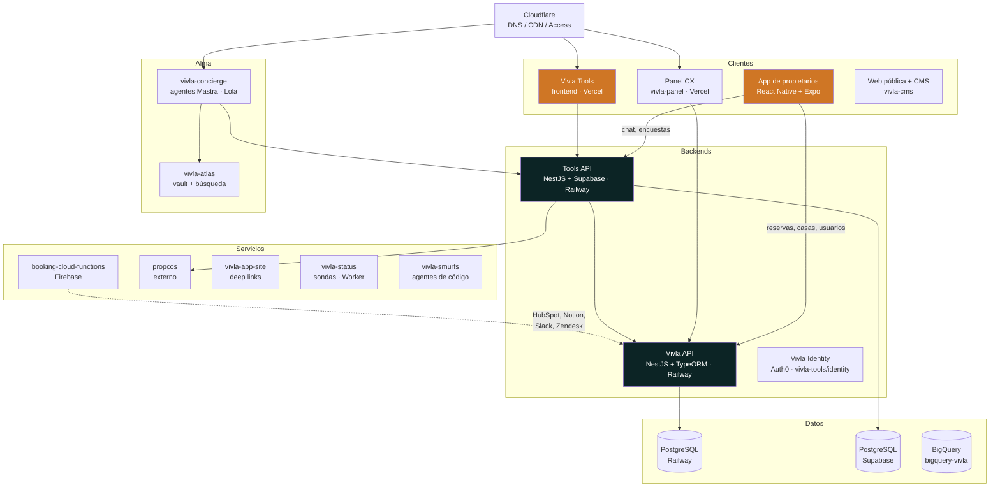

## Ecosistema VIVLA

VIVLA tiene dos backends de producto: **vivla-api** y la **Tools API** de vivla-tools. Alrededor viven los agentes de Alma, la web pública, los datos y la monitorización. Cloudflare da DNS, CDN y control de acceso (Access) a casi todo.

<Note>
  La **app de propietarios** consume **dos backends**: vivla-api para reservas, casas, usuarios y auth, y la **Tools API** para chat y encuestas.
</Note>

## Dos backends, dos mundos

| | Vivla API | Tools API |
|---|---|---|
| **Repo** | `vivla-api` | `vivla-tools` (monorepo, `apps/backend`) |
| **Framework** | NestJS 11 | NestJS 10 |
| **Base de datos** | PostgreSQL (Railway) con TypeORM; Firestore para datos heredados | PostgreSQL (Supabase) |
| **Auth** | Auth0 (tenant `vivlapro`) | Auth0 (Vivla Identity) + API key para integraciones |
| **Clientes** | App de propietarios, Panel CX, Tools API | App (chat y encuestas), frontend de Tools, portales públicos, agentes de Alma |
| **Hosting** | Railway (`production` desde `master`, `staging` desde `stage`) | Railway (`production` desde `main`, `develop` desde `develop`) |

## Stack tecnológico

| Producto | Tecnología | Hosting |
|----------|-----------|---------|
| **Vivla API** | NestJS 11, PostgreSQL (TypeORM), Firebase, GCS | Railway |
| **Vivla Tools** | TanStack Start + NestJS + Supabase, Stream Chat, Auth0, Windmill | Backend e Identity en Railway, frontend en Vercel |
| **App de propietarios** | React Native 0.81, Expo SDK 54, TypeScript | App Store y Google Play (EAS) |
| **Panel CX** | SPA de Vite + función serverless | Vercel |
| **Web pública + CMS** | vivla-cms (Payload CMS + Next.js) | Vercel y Railway |
| **Agentes de Alma** | vivla-concierge (Mastra) y vivla-atlas (vault + búsqueda) | Railway |
| **Agentes de código** | vivla-smurfs (Mastra + Claude Agent SDK) | Railway |
| **Cloud Functions** | Firebase Functions, Node.js | Google Firebase |
| **PropCos** | propcos (desarrollo externo) | Infraestructura del proveedor |
| **Deep links** | vivla-app-site | Cloudflare Pages |
| **Monitorización** | vivla-status (sondas, página de estado, Sentry como código) | Cloudflare Workers |
| **Datos** | bigquery-vivla (Dataform, BigQuery) | Google Cloud |
| **DNS / CDN / Access** | Cloudflare, con login de Auth0 (Vivla Identity) | — |
| **Wiki** | Astro Starlight + Cloudflare Worker (sitio y MCP), detrás de Cloudflare Access | Cloudflare Workers (`wiki.vivla.com`) |

## Conexiones clave

<CardGroup cols={2}>
  <Card title="App → 2 backends" icon="mobile">
    La app consume **vivla-api** para auth, reservas, casas y estancias. Usa la **Tools API** para el chat en tiempo real y las encuestas.
  </Card>
  <Card title="Panel → Vivla API" icon="headset">
    El backoffice de CX consume la API principal para gestionar reservas y atender a los clientes.
  </Card>
  <Card title="Alma → Tools y Atlas" icon="robot">
    Concierge (Lola) lee y escribe en la Tools API y consulta Atlas y esta wiki por MCP.
  </Card>
  <Card title="Cloud Functions → Integraciones" icon="cloud">
    Firebase Functions orquesta HubSpot (CRM), Notion, Slack, Zendesk, reportes y NPS.
  </Card>
</CardGroup>

Ver [Repositorios](/repositories) para la ficha de cada repo y [Entornos](/environments) para las URLs y ramas.
