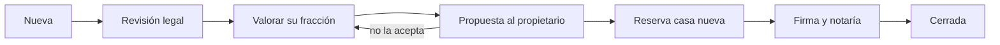

# Cambio de casa

> Documento de estado actual. Describe cómo funciona hoy el sistema, no cómo debería ser.

Un propietario puede dejar su fracción como parte del pago de una fracción en otra casa VIVLA. Legalmente es una venta de su fracción más una compra en la casa destino. Por eso en Vivla Tools es una operación del mercado secundario, con pasos propios.

Las condiciones de cada propietario (con o sin descuento, cada cuánto) están en [Condiciones del propietario](/operativa/condiciones-propietario).

---

## Los pasos

| Paso | Quién | Qué pasa |
|------|-------|----------|
| **Nueva** | Portal | El propietario pulsa **Quiero cambiarme** con su fracción y la casa destino |
| **Revisión legal** | Legal | Condiciones de cambio de su contrato, permanencia y cuotas |
| **Valorar su fracción** | Decisión | Cuánto vale su fracción como parte del pago. Hace falta para pasar a la propuesta |
| **Propuesta al propietario** | AE | Se le propone. Si no la acepta, vuelve a valorarse con un motivo |
| **Reserva casa nueva** | AE y Real Estate | Reserva de la casa destino: pago, visita, identidad verificada y cuotas al día |
| **Firma y notaría** | Legal y Finanzas | Doble notaría: sale de una casa y entra en la otra |
| **Cerrada** | — | Libro de socios actualizado |

Desde cualquier paso abierto la operación puede pasar a **Retirada** o **Rechazada**.

---

## La reserva de la casa nueva

La reserva sigue estos pasos: **Reservada**, **Visita**, **Contrato firmado**, **Notaría** y **Completada**.

- Para firmar hacen falta la reserva pagada, la identidad verificada y las cuotas al día.
- En notaría, **Registrar titularidad** crea la fracción nueva y cierra la que deja como cambio de casa.
- La ficha enseña el desglose: precio de la casa nueva, menos el valor de su fracción, menos la reserva. El resultado es lo que paga en notaría.

Documentos: el contrato de reserva de la casa nueva en la reserva y los borradores de la doble notaría en la firma, ambos en Bigle.

---

## Casos que se quedan como petición

Si **Quiero cambiarme** llega sin fracción o sin casa destino, o la fracción ya está en venta, no se abre la operación. Se queda como una petición para que CX la recoja y hable con el propietario.

<Note>
Pendiente de decidir: si la fracción que deja pasa por el derecho preferente de sus copropietarios o VIVLA la recompra siempre. Hoy el sistema asume que VIVLA la recompra.
</Note>
