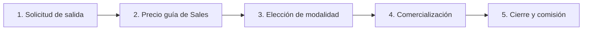

# El ciclo de una venta de fracción

> Documento de estado actual. Describe cómo funciona hoy el mercado secundario, no cómo debería ser.

El mercado secundario es la venta de fracciones que ya tienen propietario. VIVLA ya no recompra con capital propio salvo que el contrato lo obligue: **intermedia** entre el propietario que sale y un comprador nuevo, y cobra una comisión. Así el propietario tiene liquidez, entran clientes nuevos y la fracción rota sin pasar por el balance de VIVLA.

Todo se lleva en Vivla Tools, en **Mercado secundario**. Las condiciones de cada propietario están en [Condiciones del propietario](/operativa/condiciones-propietario). El cambio a otra casa tiene su propio recorrido: [Cambio de casa](/operativa/cambio-de-casa).

---

## Las tres modalidades

Sales explica las tres al propietario y él elige una. El precio esperado sube en este orden: recompra contractual, oferta directa de VIVLA y mercado abierto.

| Modalidad | Qué hace VIVLA | Vendedor | Comprador nuevo | Total |
|-----------|----------------|:---:|:---:|:---:|
| **Directa** | Recompra en los términos del contrato, o hace una oferta directa | 0 % | — | 0 % |
| **Sin maximización** | Partner operativo: derecho preferente, papeles y escritura | 2,5 % | 2,5 % | 5 % |
| **Con maximización** | Lo anterior y además comercializa: lista de espera, deals de la zona y web | 5 % | 2,5 % | 7,5 % |

- **Directa.** Si la garantía del propietario está vigente, la recompra se cumple en sus términos, al precio y en las fechas de su contrato. Si no, Sales, Real Estate y Finanzas deciden si VIVLA compra y a qué precio. La oferta llega en unos 7 días y el cierre en unas 4 semanas. VIVLA no está obligada a comprar.
- **Sin maximización.** VIVLA **no comercializa**. El comprador lo trae el propietario o sale de sus copropietarios. VIVLA lleva el derecho preferente, los documentos y la notaría.
- **Con maximización.** Es la única modalidad en la que VIVLA mueve la fracción: lista de espera de la casa, deals de la zona y publicación en la web.

El comprador nuevo paga la membership fee del 2,5 %. Si el comprador ya es propietario VIVLA, no la paga. Cualquier precio o comisión que se comunique a un propietario lo valida el VP de Sales.

---

## Los cinco pasos

### 1. Solicitud de salida

El propietario pulsa **Quiero vender** en el portal, o el equipo da de alta la solicitud a mano. Toda solicitud entra por Legal, que revisa el contrato y si hay garantía de recompra vigente.

Una solicitud antes del primer aniversario no se bloquea: la recompra se avisa entre el mes 9 y el 12. La ficha la marca para que Legal decida.

### 2. Precio guía de Sales

Sales fija un **precio guía** según la demanda real de la zona, no según el precio que pide el propietario. Se apunta en la ficha de la venta y queda en el historial cada vez que se fija o se corrige.

Una venta sin o con maximización **no puede arrancar** sin precio guía.

### 3. Elección de modalidad

Sales llama al propietario, le explica las tres modalidades y se las confirma por email. Desde aquí Sales es owner de la operación hasta el cierre.

- **Directa**: la operación pasa a **Recompra VIVLA**. Si al final VIVLA no compra o la garantía no aplica, vuelve a decidirse con un motivo.
- **Sin o con maximización**: antes hay que firmar un **acuerdo de venta vinculante** con precio, modalidad y comisiones. Después se abre el derecho preferente.

### 4. Derecho preferente y comercialización

1. **Derecho preferente (30 días).** Se notifica a los copropietarios y a VIVLA, que pueden comprar antes que nadie. No se comercializa a terceros hasta que acaba, salvo que renuncien todos.
2. **Subasta entre copropietarios (hasta 10 días).** Si hay varios interesados, pujan entre ellos. Solo pujan los copropietarios de la misma casa, nunca el vendedor. La puja tiene que llegar al precio de salida y superar la más alta. Gana la más alta.
3. **Comercialización (solo con maximización).** Si ningún copropietario compra, Sales la mueve en este orden recomendado: lista de espera de la casa, lista de espera del destino y casas parecidas, y la web. En la ficha de la venta aparecen los **deals de HubSpot de la zona que aún no tienen casa asignada**, para ofrecérsela. Si aparece un interesado claro, se puede saltar el orden.

La venta a terceros tiene que cerrarse en **180 días** desde la notificación, al mismo precio o mejor. Si baja el precio, se vuelve a notificar a los copropietarios.

### 5. Cierre y comisión

Firma del contrato privado y notaría. Antes de la notaría, Finanzas comprueba que las cuotas están al día.

Para cerrar la operación hacen falta el **precio final** y, en una reventa, el **nuevo propietario**. La comisión de VIVLA se calcula entonces y se guarda tal como se cobró. Si la fracción la compra un copropietario en subasta, queda como comprador con su puja como precio y no paga membership fee.

---

## Estados en Vivla Tools

| Estado | En pantalla | Lo mueve |
|--------|-------------|----------|
| `requested` | Nueva | Legal |
| `legal_review` | Revisión legal | Legal |
| `pending_decision` | Elegir escenario | Sales (y Finanzas y Real Estate si compra VIVLA) |
| `buyback` | Recompra VIVLA | Real Estate |
| `preferential_right` | Derecho preferente | Legal |
| `auction` | Subasta copropietarios | Legal |
| `marketing` | Comercialización | Sales |
| `closing` | Firma y notaría | Legal y Finanzas |
| `closed` | Cerrada | — |

Desde cualquier estado abierto la operación puede pasar a **Retirada** (el propietario se echa atrás) o **Rechazada** (Legal la para). Todo cambio queda en el historial con quién y por qué.

---

## Documentos de cada paso

| Paso | Documento | Dónde se hace |
|------|-----------|---------------|
| Derecho preferente | Mandato de venta | Bigle |
| Derecho preferente | Notificación del derecho preferente | PDF de Vivla Tools |
| Firma y notaría | Contrato privado de compraventa | Bigle |
| Firma y notaría | Borradores para notaría | Bigle |
| Cerrada | Factura de intermediación | Finanzas |

Al llegar a cada paso, sus documentos aparecen como pendientes en la ficha de la venta.

---

## Quién está en cada operación

Cada operación tiene su propio canal privado de Slack, creado automáticamente. Cada persona entra en el paso en que le toca y se queda hasta el final:

| Paso | Entran |
|------|--------|
| Nueva | Seguimiento (VP de Sales), CX del cliente, Legal y el AE que le vendió la fracción |
| Elegir escenario | Decisión (Finanzas) |
| Firma y notaría | Finanzas |

En cada cambio de paso se publica un mensaje en el canal. Al cerrar, retirar o rechazar la operación, el canal se archiva.

---

## Qué ve el propietario

En el portal del propietario ve:
- el valor estimado de su fracción;
- sus condiciones (ver [Condiciones del propietario](/operativa/condiciones-propietario));
- las tres modalidades con la comisión que paga él;
- en qué paso está su venta.

Si es copropietario de una casa con una fracción en subasta, también puede pujar desde ahí.

---

## Pendiente de decidir

- Prioridad entre una fracción del secundario y el stock primario en la misma zona.
- Retribución del AE en las ventas del secundario.
