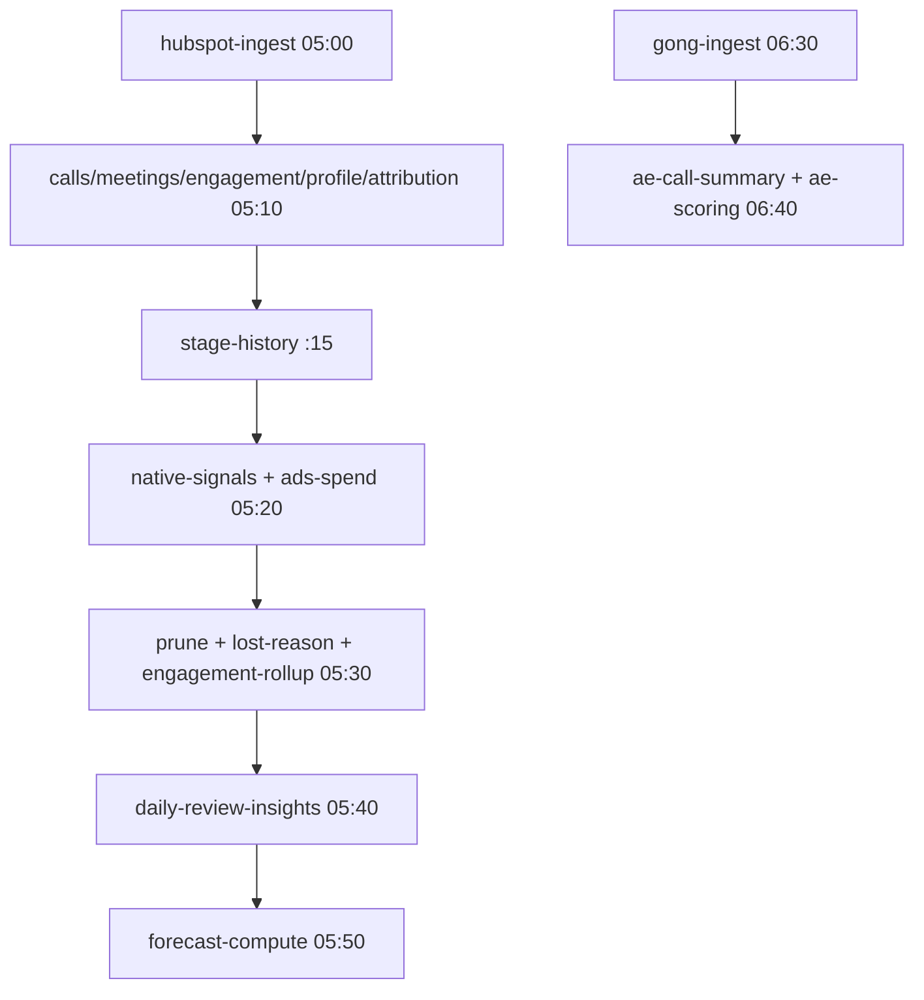

## Tareas programadas (crons)

Cada servicio de cron es un worker de `packages/ingest` que el dispatcher `scripts/railway-start.sh` arranca según `RAILWAY_SERVICE_NAME`. Todos registran su resultado en la tabla `cron_runs` (vía `withCronRun`, `packages/ingest/src/ops/cron-runs.ts`).

<Warning>
  **Las schedules de los crons NO están en git.** Se editan en Railway (o por la mutación GraphQL `serviceInstanceUpdate`, que acepta `cronSchedule` sin redeploy). El **único registro en el repo** son los comentarios `Cron suggestion:` de `scripts/railway-start.sh`: si mueves una schedule, actualízalos o quedan mintiendo (`CLAUDE.md` «El horario de la cascada diaria»).
</Warning>

### La cascada diaria (todo UTC)

El orden importa: cada eslabón lee lo que dejó el anterior. Upstream (fuera de nuestro control): DTS de HubSpot **02:00** (acaba ~03:30), Meta ~02:15, Google Ads ~02:30, export de Gong ~06:07 (es de Gong, no lo controlamos).

La rama HubSpot cierra ~**05:51 UTC** (07:51 Madrid) y la rama Gong a las 06:40. Dos detalles que no lo son:

- **`hubspot-stage-history-sync` va a `:15`, no en punto.** A las 05:00 correría a la vez que el ingest, y `daily-review-insights` (05:40) y `forecast-compute` (05:50) leerían `deal_stage_history` rancio en silencio.
- **`hubspot-ingest` aborta si el BQ nativo lleva `>20 h` sin escribirse.** Un «BQ nativo rancio» en `cron_runs` es el guard evitando reprocesar el snapshot de ayer, no un bug (ver [Fuentes de datos](/sistemas/micaela/fuentes-de-datos)).

### Crons de alta frecuencia (fuera de la cascada)

| Worker | Cadencia sugerida |
|---|---|
| `aircall-sync`, `daniela-contacts-sync` | cada 5 min |
| `daniela-profiles-sync`, `daniela-transcripts-sync`, `whatsapp-sync`, `whatsapp-scoring` | cada 15 min |
| `hubspot-scores-push` | `*/15 * * * *` |
| `daniela-enrichments-sync`, `gong-transcripts-sync`, `tofu-score-sync`, `hubspot-list-membership-sync` | cada 60 min |
| `property-preferences-extract` | cada 30–60 min |
| `report-slack-digest` | cada hora (`0 * * * *`) |
| `watchdog` | cada 15 min |

(Cadencias según los comentarios `Cron suggestion:` de `scripts/railway-start.sh`; la schedule real vive en Railway.)

<Danger>
  Dar de alta un cron nuevo son **TRES pasos**, y el tercero se olvida: (1) crear el servicio a mano en Railway, (2) ponerle la schedule **y** su comentario `Cron suggestion:`, (3) **añadirle `SENTRY_DSN`** (no se hereda — ver abajo). Un servicio de Railway **sin `cronSchedule` no es un cron**: arranca, termina y Railway lo **reinicia en bucle**; con `--escribir-de-verdad` eso son escrituras reales a HubSpot cada pocos segundos. Pon la schedule ANTES de conectar el repo (`CLAUDE.md`).
</Danger>

### Informes GTM

`pnpm reports:gtm` genera informes de GTM (`scripts/reports/gtm-reports.ts`); `report-slack-digest` publica en Slack el enlace a los informes que tocan hoy. La hora de cada informe vive en `report_subscriptions.hora_utc`, no en la schedule del cron: por eso corre cada hora y el worker filtra las horas ya pasadas (recupera un fallo en la siguiente pasada).

## Sentry

La instrumentación tiene **un solo dueño**, `packages/ingest/src/ops/sentry.ts`; las tres superficies lo llaman y ninguna configura Sentry por su cuenta (`instrumentation.ts` en web, `apps/mcp/src/instrument.ts` en mcp). Puntos clave:

- **Sin `SENTRY_DSN`, `initSentry` es un no-op total.** Es la garantía de rollback (borrar la variable apaga la emisión sin desplegar) y lo que mantiene el dev local en silencio.
- **El entorno nunca cae a `production`:** `SENTRY_ENVIRONMENT` → `RAILWAY_ENVIRONMENT_NAME` → `local` (`sentry.ts:43`). El dev local va contra la BD de prod, así que sellar sus eventos como `production` contaminaría las reglas de alerta.
- **Procesos cortos deben VACIAR antes de salir.** Los ~40 CLIs de `ingest` acaban en `process.exit()`, que no ejecuta los `beforeExit` de Node donde el SDK entrega su cola. Sin `await vaciarSentry()` la instrumentación entera es un **no-op silencioso**: el código corre, no lanza, `cron_runs` queda impecable y a Sentry no llega nada. La llamada vive en `withCronRun` (ambos caminos). Cualquier proceso corto nuevo necesita lo mismo (`sentry.ts:88`, `CLAUDE.md`).

### Prueba de humo de Sentry (`sentry:humo`)

`scripts/sentry-smoke.ts` cierra ese hueco: **emite desde un proceso hijo que muere con `process.exit()` igual que un cron**, y desde el padre comprueba que el evento llegó de verdad al proyecto (`vivla-lifestyle/micaela`).

<Steps>
  <Step title="Emitir">
    `SENTRY_DSN='…' pnpm sentry:humo` lanza el hijo con un marcador único por ejecución. Sin `SENTRY_ENVIRONMENT` fuerza `staging`; **rechaza `production`** para no ensuciar el canal de alertas.
  </Step>
  <Step title="Afirmar la llegada">
    Con `SENTRY_AUTH_TOKEN` además, consulta la API de Sentry por el marcador (hasta 20 s) y **sale con código distinto de cero si el evento no aparece**. Eso lo hace usable como puerta antes de tocar `sentry.ts`.
  </Step>
  <Step title="Sin token">
    Sin `SENTRY_AUTH_TOKEN` emite igual e imprime el marcador para buscarlo a mano, pero no afirma nada.
  </Step>
</Steps>

El workflow `.github/workflows/sentry-smoke.yml` corre esta prueba **cada noche a las 06:20 UTC** (tras cerrar la rama HubSpot) y a mano (`workflow_dispatch`). **No corre en cada PR** a propósito: emite eventos de verdad al proyecto. Exige `vars.SENTRY_DSN` + `secret.SENTRY_AUTH_TOKEN` (scopes `project:read` y `event:read`); si falta alguno, el job falla en vez de pasar en verde sin comprobar nada.

<Warning>
  **Un cron sin `SENTRY_DSN` no tiene síntoma:** corre perfecto, escribe su fila en `cron_runs`, el watchdog lo da por sano… y en Sentry no existe. Hoy **nada verifica** que un cron nuevo tenga la DSN; la comprobación es manual (censo con `railway variables` servicio a servicio, receta en `CLAUDE.md`). Corre ese censo después de crear un cron.
</Warning>

## Las tres capas de monitorización

`docs/monitoring.md` del repo define tres capas complementarias, todas apuntando a **`#micaela-alerts`** en Slack:

| Capa | Qué detecta | Implementación |
|---|---|---|
| 1 — Railway native | Deploy fallido, crash, OOM, restart loop | Webhooks de Railway → Slack |
| 2 — Watchdog Postgres + Slack | Cron que no corre, falla o no trae datos; servicio HTTP caído | Servicio `watchdog` (cron `*/15`) |
| 3 — Healthchecks.io | Caída total de Railway o Postgres (capa 2 muerta) | Dead-man's switch externo |

### Sondas de estado (healthchecks)

- **web:** `GET /api/health/live` → `{status:"ok"}` (es el healthcheck de `railway.json`); `GET /api/health/ready` ejecuta `select 1` contra la BD y responde `503` si falla (`apps/web/src/app/api/health/{live,ready}/route.ts`).
- **mcp:** `GET /health/ready` (`apps/mcp/README.md`).

### Watchdog (capa 2)

El servicio `watchdog` (`packages/ingest/src/workers/watchdog.ts`) cada 15 min lee `cron_runs` y detecta por job: `stale` (no ha corrido en su umbral), `failed` (último run con error) y `zero_rows` (N runs exitosos con 0 filas, solo para `aircall-sync` y `daniela-contacts-sync`); además hace `GET` a los healthchecks de web y mcp y alerta `http_down` si no es 2xx. Postea agregado a Slack solo si hay novedades, re-alerta cada `WATCHDOG_REALERT_WINDOW_MIN` (default 60) y manda «Recovered» al resolverse. El anti-spam vive en la tabla `watchdog_state`.

Umbrales de ejemplo (catálogo completo en `watchdog.ts` y `docs/monitoring.md`): `aircall-sync` 20 min, `hubspot-ingest` 26 h, `gong-ingest` 28 h, `daniela-profiles-sync` 45 min.

<Warning>
  `docs/monitoring.md` es una **guía de setup**, no un inventario en vivo. Qué capas están realmente activas hoy en Railway/Slack/Healthchecks.io y el valor de `WATCHDOG_WEB_HEALTH_URL`/`WATCHDOG_MCP_HEALTH_URL` son **PENDIENTE de confirmar**.
</Warning>
