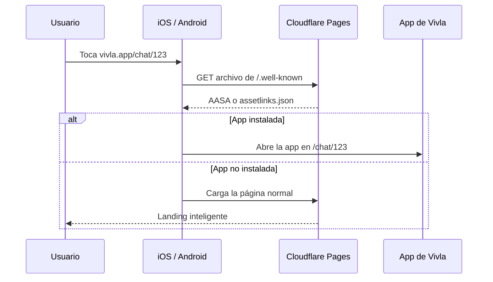

**vivla-app-site** es un sitio estático en **Cloudflare Pages**. Hace dos cosas (`README.md:3`):

1. Sirve los archivos de verificación que iOS y Android consultan para decidir si un enlace `vivla.app` abre la app en vez del navegador.
2. Si la app no está instalada, muestra una **landing** que detecta la plataforma y ofrece descargar en App Store o Google Play.

No tiene backend ni base de datos: es la carpeta `public/` publicada tal cual, más una **Pages Function** (`functions/_middleware.js`) que personaliza algunas respuestas por dominio. No hay paso de build (`wrangler.toml:3`, `package.json:5`).

<Info>
  Propietario: equipo **mobile**. Clase: **web**. La rama de producción es `main` y la fuente de verdad de esta sección es el código de esa rama. Para su sitio en el mapa de repos, mira [Repositorios](/repositories) y [Entornos](/environments).
</Info>

## Quién lo usa

- **El sistema operativo del móvil** (iOS y Android) descarga los archivos de `/.well-known/` al instalar o actualizar la app, para habilitar Universal Links y App Links.
- **Personas que tocan un enlace `vivla.app`** (por ejemplo `vivla.app/chat/123`): si tienen la app, el SO las lleva a ella; si no, caen en la landing.
- **La app móvil** (`vivla-mobile-app`) depende de que estos archivos listen sus identificadores. Los esquemas y rutas de la landing están copiados de la app (`public/index.html:258`, `public/index.html:266`).

## Cómo funciona un deep link



(`README.md:9`)

## Estructura del repo

```
functions/
  _middleware.js                      Pages Function: AASA por dominio + meta tags
public/
  .well-known/
    apple-app-site-association        AASA de iOS (sin extensión)
    assetlinks.json                   App Links de Android
  index.html                          Landing con detección de plataforma
  _headers                            Content-Type, CORS y cabeceras de seguridad
  _redirects                          Fallback a la landing
  vivla-logo.png / og-image.png / favicon.ico / apple-touch-icon.png
wrangler.toml                         Config de Cloudflare Pages
```

(verificado contra el árbol del repo; `README.md:56`)

## Dónde seguir

<CardGroup cols={2}>
  <Card title="Verificación de deep links" icon="link" href="/sistemas/vivla-app-site/verificacion-deep-links">
    AASA, assetlinks.json, dominios por entorno y la Pages Function que los sirve.
  </Card>
  <Card title="Landing" icon="mobile" href="/sistemas/vivla-app-site/landing">
    Detección de plataforma, reapertura por esquema y meta tags por ruta.
  </Card>
  <Card title="Despliegue y operación" icon="server" href="/sistemas/vivla-app-site/despliegue">
    Cloudflare Pages, entornos, deploy manual, rollback y monitorización.
  </Card>
  <Card title="Integraciones" icon="plug" href="/sistemas/vivla-app-site/integraciones">
    Quién le llama, a qué llama y credenciales solo por nombre.
  </Card>
  <Card title="Runbook" icon="life-ring" href="/sistemas/vivla-app-site/runbook">
    Equipo responsable y fallos más comunes con su arreglo.
  </Card>
</CardGroup>
