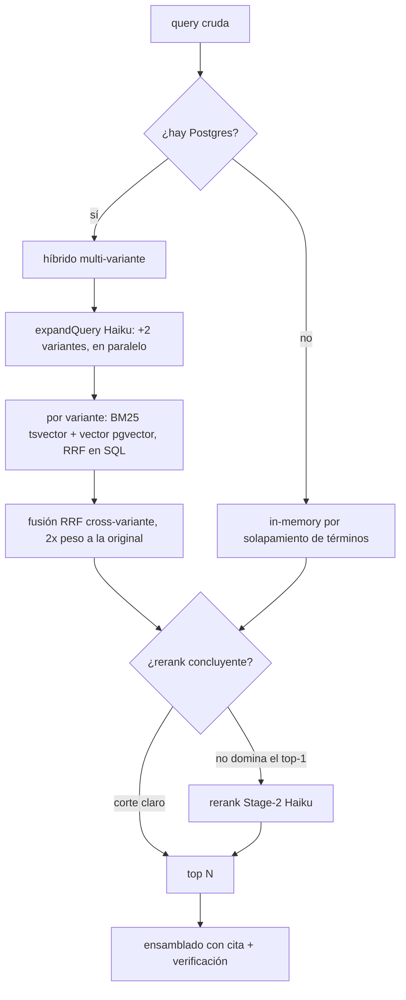

Atlas expone dos superficies sobre el mismo motor de búsqueda: una **API HTTP** (Hono) y un **servidor MCP** para agentes. Ambas comparten el pipeline de `searchVault` y la caché (`apps/server/src/index.ts`, `apps/server/src/mcp.ts`).

## Endpoints HTTP

| Método | Ruta | Qué hace | Gate |
|---|---|---|---|
| `GET` | `/health` | Estado + nº de chunks + qué capas están activas | Abierto |
| `POST` | `/buscar` | Busca y devuelve resultados con cita | Protegido |
| `POST` | `/reload` | Recarga el vault desde disco y re-sincroniza el índice (202, en background) | Protegido |
| `ALL` | `/mcp` | Servidor MCP (Streamable HTTP, stateless) | Protegido |
| `POST` | `/solicitudes` | Crea una solicitud de cambio | Protegido |
| `GET` | `/solicitudes` | Lista solicitudes (filtra por `doc_path`, `area`, `estado`) | Protegido |
| `PATCH` | `/solicitudes/:id` | Resuelve una solicitud (`aplicada`/`rechazada`) | Protegido |

Fuente: `apps/server/src/index.ts`. El gate (auth) se detalla en [Despliegue](/sistemas/vivla-atlas/despliegue); `/health` queda siempre abierto porque es el healthcheck de Railway.

### POST /buscar

Cuerpo (`SearchRequest`, `apps/server/src/types.ts`):

```json
{
  "query": "check-in casa saona",
  "audience": "owner",
  "area": "cx",
  "property": "casa-saona",
  "limit": 6
}
```

- `query` (requerido, string): la pregunta tal cual del usuario. La expansión y el rerank ocurren dentro del servicio, no se pre-reescribe en el llamante.
- `audience` (opcional): por defecto `public`.
- `area` (opcional): restringe a un área.
- `property` (opcional): slug o hid; ver [reglas de propiedad](/sistemas/vivla-atlas/vault#reglas-de-propiedad-property-ids-property-hids).
- `limit` (opcional): por defecto **6**.

La respuesta lleva `query`, `audience`, `count` y `results`, y **cada resultado lleva su cita obligatoria** (`path`, `title`, `area`, `owner`, `heading`, `verified_until`, `status`) (`apps/server/src/index.ts`, `apps/server/src/types.ts`).

## Tools MCP

El servidor MCP se llama `atlas` y expone cinco tools (`apps/server/src/mcp.ts`):

<AccordionGroup>
  <Accordion title="buscar_atlas">
    Busca en el conocimiento institucional y devuelve fragmentos con cita y verificación. Params: `query`, `audience`, `area`, `property`, `limit`. Si no hay resultados verificados, devuelve un texto que instruye al agente a responder «te confirmo con el equipo».
  </Accordion>
  <Accordion title="listar_areas">
    Mapa de conocimiento: qué áreas hay en el vault y cuántos documentos en cada una. Se deriva de los chunks cargados (no de una constante), así que refleja el vault real. Cacheado con TTL.
  </Accordion>
  <Accordion title="obtener_documento">
    Documento completo por `path`: une los apartados en orden con su cabecera (área, verificación). **No aplica el filtro de propiedad** (ver aviso en [El vault](/sistemas/vivla-atlas/vault#reglas-de-propiedad-property-ids-property-hids)).
  </Accordion>
  <Accordion title="solicitar_cambio">
    Registra una solicitud de cambio sobre un doc (o a nivel de área). Admite cuerpos largos (reescrituras enteras). No aplica el cambio: lo propone y queda en una cola.
  </Accordion>
  <Accordion title="listar_solicitudes">
    Lista las solicitudes (por defecto las pendientes); filtra por `doc_path`, `area` o `estado`. Útil para evitar duplicados antes de proponer un cambio.
  </Accordion>
</AccordionGroup>

El servidor MCP es **stateless**: se construye un `McpServer` + transport nuevo por cada request (`apps/server/src/index.ts`, `apps/server/src/mcp.ts`).

## El pipeline de búsqueda

`searchVault` tiene dos caminos según haya o no Postgres; el contrato de salida (`SearchResult` con cita) es idéntico en ambos (`apps/server/src/search.ts`).



Puntos clave (`apps/server/src/search.ts`, `apps/server/src/db.ts`):

- **Filtros del dominio antes de rankear**: `tier = 1`, área opcional, solapamiento de audiencia, no-`stale` y propiedad fail-closed. En el camino Postgres son la CTE `eligible`; en memoria son los `continue` de `searchVault`.
- **Expansión multi-variante**: Haiku genera 2 reformulaciones; se buscan en paralelo con la original y se fusionan por RRF (`RRF_K = 60`), con **peso doble a la query original**.
- **Rerank Stage-2 condicional**: Haiku reordena el top ~15 por relevancia, pero **se salta** si el corte RRF ya es concluyente (el top-1 domina al primer excluido por un margen, `ATLAS_RERANK_SKIP_MARGIN`, default 0.25). Así no se paga ~1–2 s de Haiku cuando no hace falta.
- **Todo fail-soft**: sin Haiku, la query va cruda (passthrough); sin embedder, solo BM25; si una variante peta, se ignora sin tumbar el resto.

### Caché

Hay una caché in-memory con TTL corto (default **5 min**, `ATLAS_CACHE_TTL_MS`) por clave normalizada (`query` en minúsculas/trim + `audience` + `area` + `property` + `limit`). `POST /reload` la invalida entera. `property` **forma parte de la clave** para no servir una búsqueda general cacheada a una petición con casa, ni compartir caché entre casas distintas (`apps/server/src/cache.ts`).

## El índice Postgres

Es un índice **derivado y reconstruible** (la verdad sigue en git). Si no hay `ATLAS_DATABASE_URL`, el servicio ni lo instancia y usa el fallback in-memory (`apps/server/src/db.ts`).

- **Tabla `atlas_chunks`**: una fila por chunk, con `search_vec` (`tsvector` generado, pesos A/B/C para título/apartado/cuerpo, config `spanish`), `embedding vector(1024)`, `property_ids`/`property_hids` y metadatos. Índices GIN (tsvector + propiedades) y HNSW (coseno) (`apps/server/src/migrations/001_atlas_chunks.sql`, `003_atlas_chunks_property_hids.sql`).
- **Migraciones idempotentes**: `ensureSchema` re-aplica los ficheros SQL en cada arranque (`IF NOT EXISTS` / `GENERATED`) (`apps/server/src/db.ts`).
- **Reindex incremental**: `reindex` sincroniza vault → DB por `content_hash`; solo escribe y re-embebe lo nuevo o cambiado, borra lo que ya no está, todo en una transacción (el índice anterior sigue consultable hasta el COMMIT) (`apps/server/src/db.ts`).

<Note>
  El reindex se dispara en el arranque y en `POST /reload`, **en background**: el servidor levanta primero para que el healthcheck de Railway pase sin esperar. En un arranque en frío con la tabla vacía, Postgres devuelve poco hasta que termina el reindex (`apps/server/src/index.ts`).
</Note>

## Solicitudes de cambio

La cola de solicitudes vive en el mismo Postgres (tabla `solicitudes`, `apps/server/src/migrations/002_solicitudes.sql`). Es la **verdad** de las propuestas (no se regenera desde git). Sin Postgres, las rutas de solicitudes responden `503` con un mensaje claro sin tumbar el resto del servicio (`apps/server/src/index.ts`, `apps/server/src/solicitudes.ts`).

La identidad del solicitante no la fija el cliente: el proxy de Cloudflare Pages la pisa con el email de Cloudflare Access antes de llegar al servidor (ver [Integraciones](/sistemas/vivla-atlas/integraciones)).
