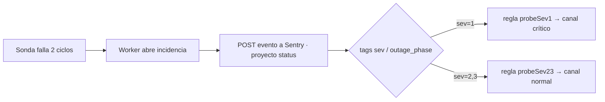

## El cron del Worker

El Worker se dispara con un cron de Cloudflare **cada minuto** (`* * * * *`, el mínimo que permite Cloudflare) (`wrangler.jsonc`). En cada ciclo `scheduled()` (`src/index.ts:295`):

<Steps>
  <Step title="Sondea">
    Lanza las 18 sondas en paralelo (ver [Sondas y aserciones](/sistemas/vivla-status/sondas)).
  </Step>
  <Step title="Sigue incidencias">
    `trackIncidents` abre o cierra incidencias y decide qué reportar a Sentry.
  </Step>
  <Step title="Persiste">
    `persist` escribe los resultados en `checks` y en el rollup `daily`.
  </Step>
  <Step title="Check-in y poda">
    Hace el check-in a Sentry (cada 5 min) y poda `checks` de más de 48 h.
  </Step>
</Steps>

<Warning>
  El orden importa: `trackIncidents` se ejecuta **antes** que `persist` porque lee el ciclo anterior desde `checks` para aplicar la regla de dos fallos. Invertirlos haría que leyera el ciclo actual y cada primer fallo pareciera su propio predecesor (`src/index.ts:299`).
</Warning>

## Dos fallos antes de una incidencia

Una incidencia necesita **dos ciclos fallidos consecutivos**. Medido en los primeros dos días, cada incidencia duraba exactamente 60 s (un ciclo fallido recuperado por el siguiente, siempre un timeout), y las tres sondas de vivla-api fallaban en el mismo segundo: eso no son tres fallos, es un momento de inalcanzabilidad. La detección pasó de ~1 min a ~2 min y nadie se despierta por un parpadeo de red (`src/index.ts:168`, `HANDOVER.md`).

La incidencia se registra con `started_at = now - 60` para apuntar al primer fallo real, no al segundo ciclo (`src/index.ts`).

## Recordatorios de caída

El Worker reporta **un evento por caída, no por sonda** (una sonda rota falla 1440 veces al día). Reporta la transición a fallo (`outage_phase=open`) y luego **un recordatorio cada 30 minutos** mientras la caída sigue abierta (`outage_phase=ongoing`). Un `fingerprint` por objetivo apila las caídas repetidas de lo mismo en una sola incidencia con histórico (`src/index.ts:44`, `src/sentry.ts:63`, `HANDOVER.md`).

## El check-in: vigilar al vigilante

Si el Worker deja de correr, la página se congela en sus últimos valores y mostraría verde durante una caída. Para evitarlo, el Worker hace un check-in a un monitor de cron de Sentry (`src/index.ts:276`):

- Las sondas corren cada minuto, pero el check-in se envía **cada 5 minutos** (`Math.floor(now / 60) % 5`), para no gastar 43k check-ins al mes diciendo lo mismo.
- Usa el secreto `SENTRY_CRON_URL`. Un check-in fallido nunca hace fallar el ciclo que produjo resultados reales.

Además, la página se marca **obsoleta** si el dato más reciente tiene más de **600 s** (`STALE_AFTER_SECONDS`), de modo que una página congelada se delata sola (`src/index.ts:42`).

## Cómo llega una caída de sonda a Slack

Para los objetivos que Sentry no puede vigilar (vivla-api y la sonda de MyInvestor, en `*.railway.app`), la única vía a un teléfono es este Worker (`src/sentry.ts:5`):



El evento se envía como envoltorio crudo por `fetch`, sin SDK: una página de estado no tiene por qué cargar una librería de trazas. Lleva `level` según `sev` (1→error, 2→warning, 3→info), `fingerprint` por objetivo y tags `sev`, `outage_phase`, `target`, `component`, `source=vivla-status` (`src/sentry.ts`).

## Sentry como código

El lado de Sentry está **declarado en `sentry/config.json`** en vez de pinchado en la UI, para poder revisarlo en un pull request y recrearlo tras un error. Todo se creó a mano por la API el 11–12 de agosto de 2026; el fichero es ese estado escrito (`sentry/config.json`).

<Info>
  Organización `vivla-lifestyle`, región **`https://de.sentry.io`**. La región importa: `sentry.io` sin ella no devuelve nada (`HANDOVER.md`, `sentry/config.json`).
</Info>

`sentry/apply.mjs` compara el fichero con lo que Sentry tiene y, opcionalmente, crea lo que falta (`sentry/apply.mjs`):

```bash
export SENTRY_AUTH_TOKEN=sntryu_...   # token de USUARIO, no sntrys_
node sentry/apply.mjs                 # simulacro, imprime diferencias
node sentry/apply.mjs --write         # crea lo que falta
```

<Warning>
  Un token de **organización** (`sntrys_`) devuelve `403` en todo: Sentry los limita a tareas de CI. Hace falta un token de **usuario** (`sntryu_`) con `project:read`, `project:write`, `alerts:read`, `alerts:write` y `org:read` (`sentry/apply.mjs`, `HANDOVER.md`).
</Warning>

El script **solo crea lo que falta**: nunca edita ni borra una regla existente, y empareja por nombre, así que renombrar una regla en la UI hace que el script cree un duplicado en vez de pisar el cambio (`sentry/apply.mjs`).

### Qué declara el fichero

- **Monitores de uptime** (7): Tools backend, Tools web, Home Excellence, Panel de reservas, portada y ficha de vivla.com, y la propia página de estado (`sentry/config.json`).
- **Monitor de cron** (1): `vivla-status-worker`, espera un check-in cada 5 min; sin él una parada del Worker dejaría la página congelada en verde (`sentry/config.json`).
- **Reglas de alerta** por proyecto: `down`, `volume`, `regression`, `users`, `probeSev1`, `probeSev23`. El reparto no es simétrico a propósito: un proyecto solo recibe las reglas cuya señal es fiable ahí (`sentry/config.json`).
- **Canales de Slack**: `#alertas-tekis-critico` (crítico) y `#alertas-tekis` (normal) (`sentry/config.json`).

<Note>
  Lo que Sentry **no** cubre está declarado también en el fichero: `api-vivla` queda fuera porque su `Sentry.init()` corre dentro de `bootstrap()` y pierde parte de la instrumentación; y `*.railway.app` no se puede vigilar porque agotó un tope de 1000 monitores compartido entre todos los clientes de Sentry. Esos objetivos los cubren las sondas de este Worker (`sentry/config.json`, `HANDOVER.md`).
</Note>
