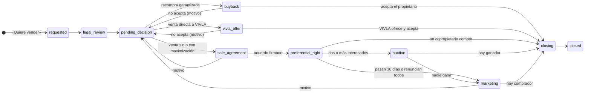

# Mercado secundario

Herramienta de Legal, CX y Sales para llevar la venta de fracciones entre
propietarios. Cada solicitud de un propietario que quiere vender entra aquí,
pasa por Legal y avanza paso a paso hasta la escritura. Todo cambio queda en el
historial con quién lo hizo y por qué. Es la base del portal financiero del
propietario (VIV-3017): también llegan aquí las peticiones, las reservas de
otra casa y las pujas entre copropietarios que se hacen desde la app.

## Rutas

| Ruta | Qué hay |
|------|---------|
| `/app/secondary-market` | Operaciones, en cuatro pestañas (`?tab=`): **Resumen** (cinco KPIs, acciones prioritarias y dónde está lo activo), **Lista** (vistas guardadas `?vista=` Todas, Legal, Ventas, Finanzas, Vencidas y Cerradas; KPIs sobre lo filtrado; buscador y filtros por paso, equipo, comercial, escenario y antigüedad; «Por confirmar con el propietario» arriba), **Tablero** (cuatro columnas por fase, Entrada · Decisión · Venta · Firma, con los pasos como carriles y «Por confirmar» el primero) y **Plazos y alertas** (todas las alertas, el calendario de plazos del COS y la antigüedad) |
| `/app/secondary-market/$requestId` | Ficha: fracción, plazos del COS, siguiente paso (qué falta), datos por bloques, actividad, documentos, deals de la zona, pujas si hay subasta, historial y simulador de fees |
| `/app/secondary-market/inbox` | Bandeja del portal, en dos pestañas: **Peticiones** (vender, cambio de casa, informe personalizado, asesor, probar destino y comprar otra casa) y **Reservas** de otra casa (lo que falta para firmar) |
| `/app/secondary-market/requests/$ownerRequestId` | Ficha de la petición: qué hacer, «Me la quedo», siguiente paso e historial |
| `/app/secondary-market/reservations/$reservationId` | Ficha de la reserva: desglose, checklist, fechas, registrar titularidad e historial |
| `/app/secondary-market/stock` | Stock de VIVLA: las fracciones que VIVLA ha recomprado (devoluciones) y aún no ha revendido, con coste, antigüedad, límite de recompra y comercial; debajo, las revendidas con su margen |
| `/app/secondary-market/portal` | Portal del propietario, en tres pestañas: **Visibilidad** (qué bloques del portal se enseñan, para todos o como excepción en una casa o a un propietario), **Demanda** (el semáforo de cada casa, con los interesados y la oferta del mercado, y el ajuste manual) y **Links de reserva** (el link de pago de cada casa) |

Las rutas antiguas (`/process`, `/legal`, `/sales`, `/deadlines`, `/fees`,
`/requests`, `/reservations`, `/reservation-links`, `/demand`, `/visibility`)
redirigen a la pestaña que les corresponde, así los enlaces de Slack y los
marcadores siguen funcionando. El simulador de fees ya no es una pantalla:
vive en la ficha de cada operación con el precio guía precargado.

## Permisos

Claim `tool-secondary-market`. `viewer` ve solicitudes, peticiones, reservas y
pujas, y simula fees. `editor` y `admin` además las mueven.

Lo que cada persona ve de las pujas, y si entra en los canales de Slack, no
depende del claim sino de su [perfil del secundario](#perfiles-del-secundario),
que se gestiona en Equipos.

## Flujo

Es el proceso que montó Legal (Ricardo) el 21 de octubre de 2026 sobre el
Sales Strategy de Q4 (ExCom del 15 de octubre, slides 14 y 15) y lo acordado
con Legal el 6 de octubre. Cada paso dice quién lo mueve, y la ficha dice qué
falta para pasar al siguiente: no deja avanzar si falta algo.

Los cinco pasos de la slide 14 y dónde están en tools:

| Paso | En tools |
|------|----------|
| 1. Solicitud de salida | «Estoy pensando en vender» en la app entra en «Por confirmar»: el comercial llama y, si quiere vender, «Quiere vender» abre la venta en «Nueva». Si era curiosidad, se descarta con ese motivo. También hay alta manual |
| 2. Precio guía de Sales | Bloque «Precio y escenario» de la ficha: según la demanda real de la zona, no el precio pedido. Lo valida Ricardo |
| 3. Elección de modalidad | «Elegir escenario»: recompra garantizada, venta directa a VIVLA, sin maximización o con maximización. Cada uno lleva a su paso |
| 4. Comercialización | «Venta a terceros», con o sin maximización. Solo con maximización la comercializa VIVLA (estado comercial y deals de la zona sin casa de HubSpot) |
| 5. Cierre y comisión | «Cerrar venta» pide el precio final y el nuevo propietario, y guarda la comisión de VIVLA |

| Estado | En pantalla | Lo mueve |
|--------|-------------|----------|
| `requested` | Nueva | Legal |
| `legal_review` | Revisión legal | Legal |
| `pending_decision` | Elegir escenario | Sales |
| `buyback` | Recompra garantizada | Real Estate |
| `vivla_offer` | Oferta directa de VIVLA | Ricardo y Floria |
| `sale_agreement` | Acuerdo de venta | Sales |
| `preferential_right` | Derecho preferente | Legal |
| `auction` | Subasta entre copropietarios | Legal |
| `marketing` | Venta a terceros | Sales |
| `closing` | Firma y notaría | Legal y Finanzas |
| `closed` | Vendida | — |
| `withdrawn` | No vende (el propietario no acepta, con motivo) | — |
| `rejected` | Descartada (solo curiosidad, duplicada, no cumple el contrato, el propietario la retira u otro) | — |

## Reglas que aplica

El sistema las aplica al mover cada solicitud: si falta algo, la ficha lo
dice («Para pasar a … falta: …») y el botón no deja avanzar.

- **Permanencia de un año** desde la compra (COS 8.4). Una solicitud anterior
  no se bloquea: sale marcada para que Legal decida.
- **Confirmar antes de Legal.** Una solicitud desde la app no pasa a Legal
  hasta que el comercial confirma con el propietario que quiere vender. Si
  era curiosidad, se descarta con ese motivo (Ricardo, 21 de octubre).
- **Escenario obligatorio.** Para salir de «Elegir escenario» hace falta uno,
  y cada uno lleva a su paso. El escenario solo se cambia volviendo a ese paso
  con un motivo.
- **Recompra garantizada.** Se cumple en los términos del contrato: hace falta
  confirmar que la garantía aplica. Sin garantía, Ricardo y Floria deciden si
  VIVLA ofrece comprar y a qué precio.
- **Decide el propietario.** En las directas, a firma solo se pasa si el
  propietario acepta. Si no, vuelve a «Elegir escenario» con un motivo o se
  cierra como «No vende».
- **Precio guía y acuerdo de venta.** La venta abierta no arranca sin precio
  guía, ni se notifica a los copropietarios sin el acuerdo de venta firmado
  con precio, modalidad y comisiones.
- **Validación de Ricardo.** Cualquier precio o comisión que se comunique al
  propietario lo valida Ricardo. Si cambia el precio guía, la validación se
  quita y hay que volver a validarlo.
- **Derecho preferente de 30 días** desde la notificación, salvo que renuncien
  todos. Con dos o más copropietarios interesados, subasta de 10 días. No se
  pasa a «Venta a terceros» hasta que acaban.
- **180 días para vender a terceros** desde la notificación (COS 8.5). Si el
  precio guía baja por debajo del notificado, hay que renotificar.
- **Cierre.** «Vendida» pide el precio final y, en una reventa, el nuevo
  propietario. La comisión se calcula entonces y se guarda tal como se cobró.
  Al cerrar una subasta, el ganador queda como comprador (ya es propietario,
  no paga membership fee) y su puja como precio.
- **Comisiones** (slide 15):

| Modalidad | Escenario en tools | Vendedor | Comprador nuevo | Total |
|-----------|--------------------|----------|-----------------|-------|
| Directa | Recompra garantizada | 0% | — | 0% |
| Directa | Venta directa a VIVLA | 0% | — | 0% |
| Sin maximización | Venta sin maximización | 2,5% | 2,5% | 5% |
| Con maximización | Venta con maximización | 5% | 2,5% | 7,5% |

Con maximización (5 %) VIVLA comercializa la fracción: lista de espera, deals
de la zona y web, con un estado comercial (preparando, activa, con
interesados, oferta recibida, oferta aceptada, reserva o señal, pausada). Sin
maximización (2,5 %) VIVLA es partner operativo (derecho preferente, papeles y
escritura) y el comprador lo trae el propietario. Un propietario actual que
compra no paga la membership fee.

## Alertas y plazos

Cada alerta sale de una condición de los datos. «Resolver» pide qué se ha
hecho y deja quién y cuándo; si el dato que la disparó cambia (una fecha, un
precio), vuelve a salir.

| Alerta | Cuándo | Para |
|--------|--------|------|
| Llamar al propietario | «Estoy pensando en vender» sin confirmar a las 48 h | Su comercial o dirección comercial |
| Sin comercial | En Sales sin comercial asignado | Dirección comercial |
| Permanencia | Pedida antes del año (COS 8.4), en entrada o revisión | Legal |
| Sin precio guía | 3 días en «Elegir escenario» sin precio guía | Comercial |
| Sin validar | Precio guía en uso sin la validación de Ricardo | Ricardo |
| Decisión de VIVLA | 7 días en «Oferta directa de VIVLA» sin decisión | Ricardo y Floria |
| Derecho preferente | Sin notificación, a 5 días del fin o vencido | Legal |
| Subasta | A 2 días del fin o terminada | Legal |
| 180 días | A 20 días del fin o vencidos | Comercial |
| Renotificar | El precio guía bajó después de notificar | Legal |
| Sin actividad | Venta con maximización sin actividad en 14 días | Comercial |
| Crítica | Más de 90 días desde la solicitud y 14 sin actividad | Quien la mueve |
| Sin escritura | En firma sin fecha prevista de escritura | Legal y Finanzas |
| Próxima acción | La próxima acción de la ficha está vencida | Comercial |

La antigüedad se mide desde la solicitud, en el paso actual o en venta a
terceros, con umbrales de 30 (seguimiento), 60 (prioridad alta) y 90 días
(crítica).

## Garantía del propietario

Cada fracción tiene su garantía tal como se firmó: años de recompra,
descuento el primer año y después, condiciones del cambio de casa y el
documento del que sale. Se ve y se corrige en el perfil del propietario
(pestaña «Fracciones» → «Contrato y condiciones»), con la próxima ventana de
recompra y su precio. La ficha de cada venta enseña la del vendedor.

Los datos iniciales salen de las carpetas de Drive de cada casa. Cuando un
propietario no tiene garantía firmada, la ficha lo dice («Carta de
compromiso», «Cláusula de la promesa» o «Sin garantía localizada»).

Bajo «Contrato y condiciones» también están las **condiciones especiales** de
la titularidad (VIV-3018): las suspensivas de la promesa de compraventa
(financiación, visita, revisión legal, proyecto de Vivla Studio) y la reserva
sin compromiso de la garantía. Cada una lleva su plazo (la fecha límite
explícita, o la firma más los días pactados) y su estado (pendiente, cumplida,
renunciada o desistió), y se marca «Plazo vencido» si sigue pendiente pasado el
plazo. Salen de los documentos de Drive y se añaden, editan o borran con
permiso de editor.

Y debajo, las **condiciones comerciales**: lo que comercial prometió al firmar
la compra, aparte de la garantía. Hay cinco tipos:

- **Cuotas pagadas por VIVLA** durante un tiempo o hasta un importe («6 meses
  gratis», «Primeros 6.760 € gratis», «Gratis hasta 2025»).
- **Cuota fija**: cuota de copropiedad fija durante N años, y VIVLA asume las
  derramas extraordinarias de la casa.
- **Segunda fracción**: sin cuotas durante N meses si compra otra fracción.
- **Garantía de alquiler**: puede ceder una estancia al año a VIVLA a precio
  neto de mercado, que se descuenta de la cuota.
- **Plan de referidos**: el importe por cada referido.

Cada una enlaza el documento de Drive del que sale. Son de solo lectura: se
cargan desde las carpetas de Drive (`ownership_commercial_conditions`).

## Condiciones en el portal del propietario

La pantalla «Las reglas de tu fracción» del portal enseña al propietario sus
propias condiciones, sacadas de «Contrato y condiciones»:

- la garantía de recompra (años, descuento el primer año y después, hasta
  cuándo vale y con cuántos meses de aviso);
- el cambio de casa (con o sin descuento, y si es como mucho cada 24 meses);
- la permanencia mínima y los plazos del COS (30 días de derecho preferente,
  10 de subasta y 180 para vender a terceros);
- las tres modalidades con la comisión que paga él (0 %, 2,5 % y 5 %).

La garantía también está a la vista sin entrar en las reglas: «Mi fracción»
tiene una tarjeta «Tu garantía» (recompra hasta cuándo y con qué descuento), y
«Vender» repite la garantía, el cambio de casa y la permanencia antes del
botón.

En «Vender» el propietario elige **cómo quiere vender**: directa (0 %), sin
maximización (2,5 %), con maximización (5 %) o «Aún no lo sé». Es su
preferencia, no la decisión: llega con la solicitud
(`sale_requests.preferred_modality`), queda en el historial y en el aviso de
Slack, y la ficha la enseña como «Preferencia del propietario». En el bloque
«Precio y escenario» viene preseleccionada si es sin o con maximización (la directa son
dos escenarios y se deja sin elegir). Sales la confirma después del precio
guía. «Estado de tu venta» le recuerda lo que eligió.

Nunca enseña las notas internas de Legal, el texto de una regla especial (le
dice que se la explica una persona de VIVLA) ni la comisión del comprador. Si
no hay garantía localizada, le dice que estamos revisando su contrato.

## Acciones del portal del propietario

| Botón en la app | Dónde aparece |
|-----------------|---------------|
| «Estoy pensando en vender» (con la modalidad que prefiere) | «Por confirmar» en Proceso y Ventas, y Peticiones · vender. «Quiere vender» abre la venta |
| «Quiero cambiarme» | Peticiones · cambio de casa |
| «Pedir informe personalizado» | Peticiones · informe |
| «Hablar con mi asesor» | Peticiones · asesor |
| «Probar otro destino» | Peticiones · probar destino |
| «Añade otra casa a tu cartera» (solo desde 05): «Me interesa» o «Quiero que me llamen» | Peticiones · comprar otra casa (Sales; sin membership fee) |
| «Reservar», para cambiar de casa o para comprar otra | Reservas |
| «Pujar» | Ficha de la venta en subasta |
| Firmar el mandato de venta o el contrato privado de compraventa | Documentos de la ficha de la venta (estado «Firmado») |

- **Peticiones.** Pasan de Nueva a En curso y Hecha. Para descartar una hay que escribir el motivo. La bandeja marca las que llevan más de 48 horas sin moverse.
- **Reservas.** Pasan por Reservada, Visita, Contrato firmado, Notaría y Completada.
  - Sirven para cambiar de casa (entrega su fracción) o para comprar otra sin dejar la suya.
  - El propietario paga hoy la reserva que se configura en el backend (1.500 €). El pago se marca a mano: aún no hay pasarela.
  - La reserva de un cambio de casa se enlaza sola con su venta de cambio de casa si ya está abierta.
  - El propietario solo puede firmar con la reserva pagada, la identidad verificada y las cuotas al día.
  - En notaría, «Registrar titularidad» crea la fracción nueva en Clientes. Si entregó la suya, la cierra como cambio de casa.
- **Pujas.** La subasta dura 10 días desde que la venta pasa a «Subasta entre copropietarios».
  - Es en sobre cerrado: cada copropietario de la misma casa hace una única puja, desde el precio de salida. Es vinculante y no se puede cambiar.
  - La fecha de cierre se puede cambiar en la ficha. La puja cierra al acabar ese día.
  - Lo que se ve depende del [perfil del secundario](#perfiles-del-secundario): los importes y quién ha pujado solo los ve Legal; Decisión y Seguimiento ven cuántas pujas hay y la fecha de la última; Ventas, CX y Finanzas no ven nada, ni en la tarjeta de la subasta ni en la actividad del propietario.
  - Cada puja nueva llega solo a Legal en el loop, por mensaje directo de la app de Slack «Secundario», con un botón a la ficha. No sale en el canal de la operación ni en el canal general.
  - «Cerrar subasta», solo para Legal, da la fracción a la puja más alta y pasa la venta a «Firma y notaría». Si hay empate arriba no se cierra: decide Legal.
- **Firma desde el portal.** El propietario firma el mandato de venta (en «Firmas el encargo de venta») y el contrato privado de compraventa (en la firma) sin salir del portal. Hoy la firma es su clic con fecha y hora, hasta que se integre Bigle.
- **Actividad del propietario.** Cada ficha enseña todo lo que ese propietario ha hecho desde el portal.
- **Avisos.** Cada acción nueva desde la app llega a Slack con el enlace a su ficha, salvo las pujas (ver arriba).

## Canal de Slack por operación

Cada venta y cada cambio de casa tiene un canal privado en Slack, abierto por
la app «Secundario» al crearse la petición
(`venta-<casa>-f<n>-<apellido>` o `cambio-<casa>-a-<destino>-<apellido>`).

- **Quién entra.** Desde la petición: Legal, Decisión y Seguimiento en el loop,
  el CX del cliente y el AE del deal de HubSpot. Finanzas (Carreño) entra en
  «Firma y notaría» para la factura de alquileres de la PropCo y para comprobar
  que el propietario saliente paga las cuotas hasta el día de la notaría (o su
  parte proporcional). A cada uno se le menciona con lo que le toca. A cada
  persona se la busca en Slack por sus emails de trabajo (`@vivla.com`) de
  Equipos, en orden, hasta que Slack reconoce uno: si identity propone un
  email por el nombre que no existe, vale el real.
- **Dos mensajes fijados.** La **ficha**, con los datos fijos (casa, fracción,
  compra, precio, garantía, quién está), y el **estado**, que se reescribe solo
  en cada cambio: paso, a quién le toca, plazo con semáforo 🟢🟡🔴, barra de
  pasos, lo que falta para el siguiente, escenario, precio y última actividad.
- **El hilo de la ficha es el historial**, como una issue de Linear en Slack:
  - Cada actividad apuntada en tools se publica en el hilo con el nombre de quien la escribió.
  - Cada respuesta de una persona en el hilo entra en tools como «Nota · Slack», con su autor. Editarla o borrarla en Slack la edita o la borra en tools.
  - No se sincronizan los mensajes de bots ni lo que se escribe suelto en el canal.
- **Cierre.** Al cerrar, retirar o rechazar la operación se publica un último
  mensaje y el canal se archiva.

Para ver el canal de una operación, o abrirlo a mano en las operaciones
manuales y en las que fallaron, están los endpoints `…/channel` de la API (aún
sin botón en tools).

## Perfiles del secundario

Cada persona del equipo puede tener un perfil del secundario. Se cambia en
**Equipos → ficha de la persona → Mercado secundario** (perfiles hr y admin de
`tool-equipos`) y tools lo aplica en menos de un minuto.

| Perfil | Pujas: importes y quién | Pujas: cuántas y cuándo | Canal de Slack |
|--------|:--:|:--:|--------|
| Legal | ✅ | ✅ | Desde la petición, si está en el loop. Recibe el aviso de cada puja |
| Decisión | — | ✅ | Desde la petición, si está en el loop |
| Seguimiento | — | ✅ | Desde la petición, si está en el loop |
| Ventas | — | — | Como AE de sus clientes |
| CX | — | — | Como CX de sus clientes |
| Finanzas | — | — | En «Firma y notaría», si está en el loop |
| Sin perfil | — | ✅ | No entra |

**En el loop** es un interruptor por persona para Legal, Decisión, Seguimiento
y Finanzas: con él apagado la persona ve lo mismo en tools pero no entra en los
canales. Ventas y CX entran por cliente, no por perfil. El perfil vive en
`secondary_market_profiles` y es la única fuente: si un perfil se queda sin
nadie en el loop, el canal avisa de que no hay nadie con ese perfil y se
asigna en Equipos.

## Histórico

Las operaciones anteriores a tools (Data Dashboard, pestaña «Homes
Secundario», desde febrero de 2025) se cargan con
`pnpm import:secondary-history` en `apps/backend`. Entran como solicitudes
cerradas o abiertas con canal «histórico», sus fechas reales en el historial y
sin titularidad: CX las enlaza después. Distinguen tres tipos: reventa,
recompra VIVLA y cambio de casa. En «Cerradas» están las cifras de la slide
14 (fracciones recolocadas, reventas de este año frente al anterior y GM medio
de las reventas cerradas en tools con comisión) y un resumen: vendido, mediana
de días de la solicitud al cierre y margen de las recompras.

## API

| Método | Ruta | Rol |
|--------|------|-----|
| `GET` | `/secondary-market/sale-requests?status=a,b` | viewer |
| `GET` | `/secondary-market/sale-requests/:id` | viewer |
| `POST` | `/secondary-market/sale-requests` | editor |
| `POST` | `/secondary-market/sale-requests/:id/transition` | editor |
| `PATCH` | `/secondary-market/sale-requests/:id` | editor |
| `POST` | `/secondary-market/sale-requests/:id/activities` | editor |
| `POST` | `/secondary-market/sale-requests/:id/guide-price` | editor |
| `GET` | `/secondary-market/overview` | viewer |
| `POST` | `/secondary-market/alerts/:key/resolve` | editor |
| `GET` | `/secondary-market/sale-requests/:id/zone-deals` | viewer |
| `GET` | `/secondary-market/fees/quote?scenario=&priceEur=` | viewer |
| `GET` | `/secondary-market/demand` | viewer |
| `POST` | `/secondary-market/demand/refresh` | editor |
| `PUT` | `/secondary-market/demand/:propertyId/override` | editor |
| `GET` | `/secondary-market/portal-visibility` | viewer |
| `PUT` | `/secondary-market/portal-visibility` | editor |
| `DELETE` | `/secondary-market/portal-visibility/:id` | editor |
| `GET` | `/secondary-market/owner-requests?type=&status=` | viewer |
| `GET` | `/secondary-market/owner-requests/:id` | viewer |
| `POST` | `/secondary-market/owner-requests` | editor |
| `POST` | `/secondary-market/owner-requests/:id/transition` | editor |
| `PATCH` | `/secondary-market/owner-requests/:id` | editor |
| `GET` | `/secondary-market/reservations?status=` | viewer |
| `GET` | `/secondary-market/reservations/:id` | viewer |
| `POST` | `/secondary-market/reservations` | editor |
| `PATCH` | `/secondary-market/reservations/:id` | editor |
| `POST` | `/secondary-market/reservations/:id/transition` | editor |
| `POST` | `/secondary-market/reservations/:id/ownership` | editor |
| `GET` | `/secondary-market/sale-requests/:id/auction` | viewer |
| `POST` | `/secondary-market/sale-requests/:id/bids` | editor |
| `POST` | `/secondary-market/sale-requests/:id/auction/close` | editor |
| `GET` | `/secondary-market/clients/:clientId/activity` | viewer |
| `GET` | `/secondary-market/sale-requests/:id/channel` | viewer |
| `POST` | `/secondary-market/sale-requests/:id/channel` | editor |
| `GET` | `/secondary-market/owner-requests/:id/channel` | viewer |
| `POST` | `/secondary-market/owner-requests/:id/channel` | editor |
| `POST` | `/slack/secondary/events` | Firma de Slack (`SLACK_SECONDARY_SIGNING_SECRET`) |
| `GET` | `/owners/ownerships/:id/terms` | tool-clients viewer |
| `PUT` | `/owners/ownerships/:id/terms` | tool-clients editor |
| `POST` | `/owners/ownerships/:id/terms/conditions` | tool-clients editor |
| `PUT` | `/owners/ownerships/:id/terms/conditions/:conditionId` | tool-clients editor |
| `DELETE` | `/owners/ownerships/:id/terms/conditions/:conditionId` | tool-clients editor |

La app del propietario no usa estas rutas. Entra por `/owner-portal/*` con su
propia clave (`OWNER_PORTAL_API_KEY`). El perfil del secundario se lee y se
cambia en identity: `GET` y `PUT /people/:id/secondary-profile` (hr y admin de
`tool-equipos`), con cada cambio en `identity_events`. El contrato está en
`docs/internal/secondary-market/owner-portal-api.md`.

Las reglas viven en `apps/backend/src/secondary-market/secondary-market.rules.ts`
(pasos y qué falta), `secondary-market-alerts.rules.ts` (alertas y plazos) y
`owner-portal.rules.ts`, como funciones puras con tests. El diseño completo, el modelo de datos y las
decisiones pendientes están en `docs/internal/secondary-market/README.md`.
