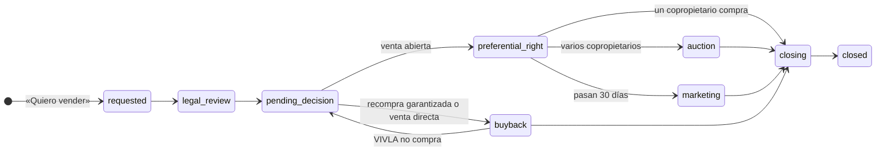

# Mercado secundario

Herramienta de Legal, CX y Sales para llevar la venta de fracciones entre
propietarios. Cada solicitud de un propietario que quiere vender entra aquí,
pasa por Legal y avanza paso a paso hasta la escritura. Todo cambio queda en el
historial con quién lo hizo y por qué. Es la base del portal financiero del
propietario (VIV-3017): también llegan aquí las peticiones, las reservas de
otra casa y las pujas entre copropietarios que se hacen desde la app.

## Rutas

| Ruta | Qué hay |
|------|---------|
| `/app/secondary-market` | Solicitudes: KPIs, filtro por fase y tabla con el plazo que bloquea cada venta |
| `/app/secondary-market/$requestId` | Ficha: fracción, plazos del COS, pujas si hay subasta, siguiente paso, actividad del propietario, historial y simulador |
| `/app/secondary-market/requests` | Peticiones: cambio de casa, informe personalizado, asesor y probar destino |
| `/app/secondary-market/requests/$ownerRequestId` | Ficha de la petición: qué hacer, «Me la quedo», siguiente paso e historial |
| `/app/secondary-market/reservations` | Reservas de otra casa: lo que falta para firmar |
| `/app/secondary-market/reservations/$reservationId` | Ficha de la reserva: desglose, checklist, fechas, registrar titularidad e historial |
| `/app/secondary-market/fees` | Simulador de fees por escenario |

## Permisos

Claim `tool-secondary-market`. `viewer` ve solicitudes, peticiones, reservas y
pujas, y simula fees. `editor` y `admin` además las mueven.

## Flujo

Acordado con Legal el 6 de octubre de 2026, con los tres escenarios del proceso
de Ricardo del 5 de octubre. Legal revisa el contrato y la garantía; Sales
explica los escenarios al propietario, se fija uno en «Elegir escenario» y
desde ahí Sales es owner hasta el cierre.

| Estado | En pantalla | Lo mueve |
|--------|-------------|----------|
| `requested` | Nueva | Legal |
| `legal_review` | Revisión legal | Legal |
| `pending_decision` | Elegir escenario | Sales (Floria y Ricardo si compra VIVLA) |
| `buyback` | Recompra VIVLA | Real Estate |
| `preferential_right` | Derecho preferente | Legal |
| `auction` | Subasta copropietarios | Legal |
| `marketing` | Comercialización | Sales |
| `closing` | Firma y notaría | Legal y Finanzas |
| `closed` / `withdrawn` / `rejected` | Cerrada / Retirada / Rechazada | — |

## Reglas que aplica

- **Permanencia de un año** desde la compra (COS 8.4). Una solicitud anterior
  no se bloquea: sale marcada para que Legal decida.
- **Derecho preferente de 30 días.** Para pasar a «Derecho preferente» hace
  falta la fecha de notificación. No se puede pasar a «Comercialización»
  hasta que acaba, salvo que renuncien todos los copropietarios.
- **Escenario obligatorio.** Para salir de «Elegir escenario» hay que fijar
  uno, y lleva a su paso: recompra garantizada o venta directa a «Recompra
  VIVLA»; venta abierta a «Derecho preferente».
- **Acuerdo de venta vinculante.** La venta abierta no arranca sin la fecha
  en que el vendedor firmó el acuerdo con precio, modalidad y fees.
- **Revisar el escenario.** Si VIVLA no compra o la garantía no aplica,
  «Recompra VIVLA» vuelve a «Elegir escenario» con un motivo obligatorio.
- **180 días para vender a terceros** desde la notificación (COS 8.5). La
  ficha enseña la fecha límite; si baja el precio, se vuelve a notificar.
- **Fees** (proceso de Ricardo, 5 oct 2026):

| Escenario | Vendedor | Comprador nuevo |
|-----------|----------|-----------------|
| Recompra garantizada | 0% | — |
| Venta directa a VIVLA | 0% | — |
| Venta abierta · VIVLA Gestora | 2,5% (5% con subasta) | 2,5% |
| Venta abierta · activación completa | 5% | 2,5% |

Un propietario actual que compra no paga la membership fee. Cualquier precio o
fee que se comunique a un propietario lo valida Ricardo.

## Garantía del propietario

Cada fracción tiene su garantía tal como se firmó: años de recompra,
descuento el primer año y después, condiciones del cambio de casa y el
documento del que sale. Se ve y se corrige en el perfil del propietario
(pestaña «Fracciones» → «Contrato y condiciones»), con la próxima ventana de
recompra y su precio. La ficha de cada venta enseña la del vendedor.

Los datos iniciales salen de las carpetas de Drive de cada casa. Cuando un
propietario no tiene garantía firmada, la ficha lo dice («Carta de
compromiso», «Cláusula de la promesa» o «Sin garantía localizada»).

## Acciones del portal del propietario

| Botón en la app | Dónde aparece |
|-----------------|---------------|
| «Quiero vender» | Solicitudes |
| «Quiero cambiarme» | Peticiones · cambio de casa |
| «Pedir informe personalizado» | Peticiones · informe |
| «Prefiero hablarlo antes» / «Hablar con mi asesor» | Peticiones · asesor |
| «Probar otro destino» | Peticiones · probar destino |
| «Reservar» | Reservas |
| «Pujar» | Ficha de la venta en subasta |

- **Peticiones.** Pasan de Nueva a En curso y Hecha. Para descartar una hay que escribir el motivo. La bandeja marca las que llevan más de 48 horas sin moverse.
- **Reservas.** Pasan por Reservada, Visita, Contrato firmado, Notaría y Completada.
  - El propietario solo puede firmar con la reserva pagada, la identidad verificada y las cuotas al día.
  - En notaría, «Registrar titularidad» crea la fracción nueva en Clientes. Si entregó la suya, la cierra como cambio de casa.
- **Pujas.** La subasta dura 10 días desde que la venta pasa a «Subasta copropietarios».
  - Solo pujan los copropietarios de la misma casa, desde el precio de salida y por encima de la puja más alta.
  - «Cerrar subasta» da la fracción a la puja más alta y pasa la venta a «Firma y notaría».
- **Actividad del propietario.** Cada ficha enseña todo lo que ese propietario ha hecho desde el portal.
- **Avisos.** Cada acción nueva desde la app llega a Slack con el enlace a su ficha.

## Histórico

Las operaciones anteriores a tools (Data Dashboard, pestaña «Homes
Secundario», desde febrero de 2025) se cargan con
`pnpm import:secondary-history` en `apps/backend`. Entran como solicitudes
cerradas o abiertas con canal «histórico», sus fechas reales en el historial y
sin titularidad: CX las enlaza después. Distinguen tres tipos: reventa,
recompra VIVLA y cambio de casa. En «Cerradas» hay un resumen: vendido, mediana
de días de la solicitud al cierre y margen de las recompras.

## API

| Método | Ruta | Rol |
|--------|------|-----|
| `GET` | `/secondary-market/sale-requests?status=a,b` | viewer |
| `GET` | `/secondary-market/sale-requests/:id` | viewer |
| `POST` | `/secondary-market/sale-requests` | editor |
| `POST` | `/secondary-market/sale-requests/:id/transition` | editor |
| `GET` | `/secondary-market/fees/quote?scenario=&priceEur=` | viewer |
| `GET` | `/secondary-market/owner-requests?type=&status=` | viewer |
| `GET` | `/secondary-market/owner-requests/:id` | viewer |
| `POST` | `/secondary-market/owner-requests` | editor |
| `POST` | `/secondary-market/owner-requests/:id/transition` | editor |
| `PATCH` | `/secondary-market/owner-requests/:id` | editor |
| `GET` | `/secondary-market/reservations?status=` | viewer |
| `GET` | `/secondary-market/reservations/:id` | viewer |
| `POST` | `/secondary-market/reservations` | editor |
| `PATCH` | `/secondary-market/reservations/:id` | editor |
| `POST` | `/secondary-market/reservations/:id/transition` | editor |
| `POST` | `/secondary-market/reservations/:id/ownership` | editor |
| `GET` | `/secondary-market/sale-requests/:id/auction` | viewer |
| `POST` | `/secondary-market/sale-requests/:id/bids` | editor |
| `POST` | `/secondary-market/sale-requests/:id/auction/close` | editor |
| `GET` | `/secondary-market/clients/:clientId/activity` | viewer |
| `GET` | `/owners/ownerships/:id/terms` | tool-clients viewer |
| `PUT` | `/owners/ownerships/:id/terms` | tool-clients editor |

La app del propietario no usa estas rutas. Entra por `/owner-portal/*` con su
propia clave (`OWNER_PORTAL_API_KEY`). El contrato está en
`docs/internal/secondary-market/owner-portal-api.md`.

Las reglas viven en `apps/backend/src/secondary-market/secondary-market.rules.ts`
y `owner-portal.rules.ts`, como funciones puras con tests. El diseño completo, el modelo de datos y las
decisiones pendientes están en `docs/internal/secondary-market/README.md`.
